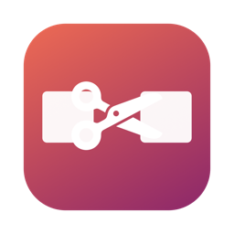
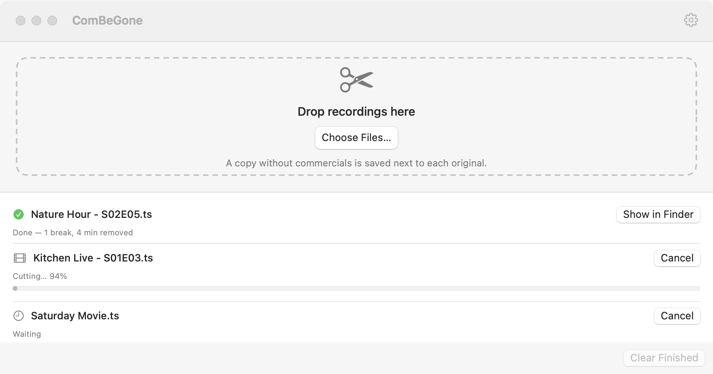
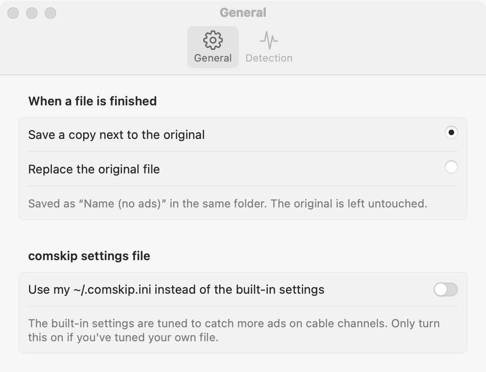
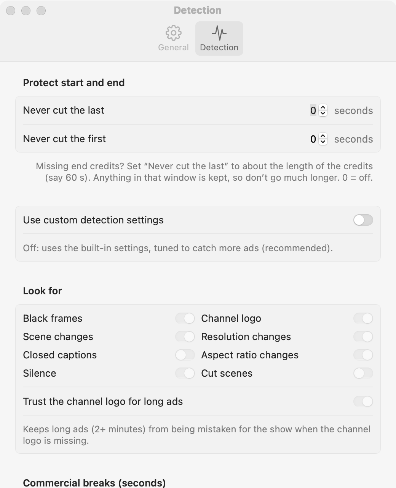
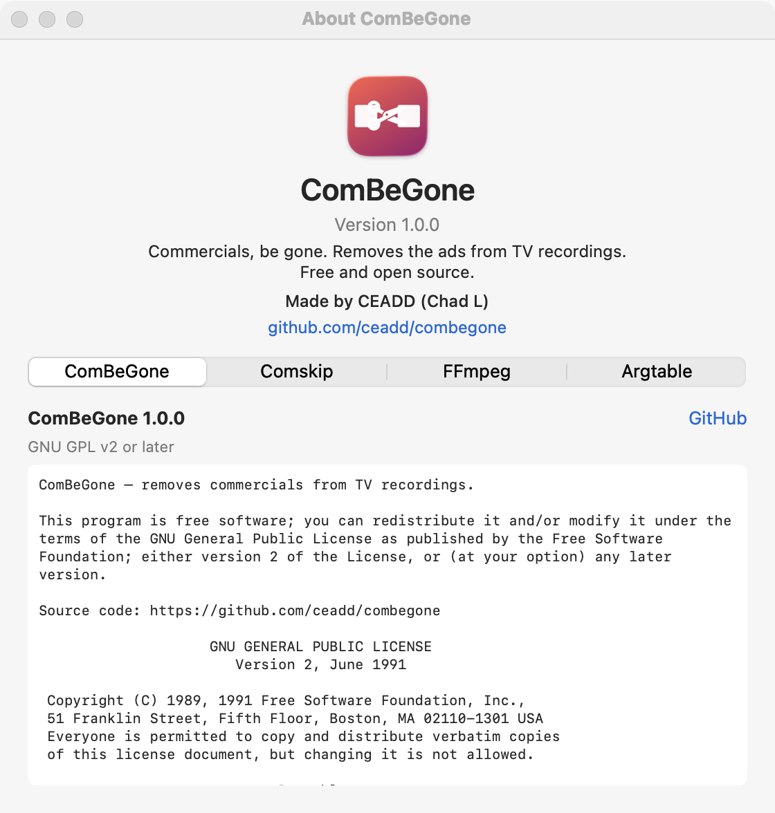

<p align="center">
  
</p>

<h1 align="center">ComBeGone</h1>

<p align="center">
  <b>Commercials, be gone.</b><br>
  Drop a TV recording on the window and get it back without the ads. Free, open source, and made for the Mac.
</p>

<p align="center">
  <a href="https://github.com/ceadd/combegone/releases/latest"><b>⬇︎ Download for Mac</b></a>
  &nbsp;·&nbsp; Apple Silicon · macOS 14+
  &nbsp;·&nbsp; Made by CEADD (Chad L)
</p>

<p align="center">
  
</p>

## Why

[Comskip](https://github.com/erikkaashoek/Comskip) is the best free tool for finding commercials in recordings, but it's a command-line program with hundreds of settings. ComBeGone wraps it, and [FFmpeg](https://ffmpeg.org) for the cutting, in a simple app. There's nothing to install and no Terminal involved.

## Features

- **Drag and drop:** drop one file or a whole stack on the window, the Dock icon, or use **Open With → ComBeGone**. Each file gets its own progress bar.
- **Your original stays safe:** the cleaned copy is saved next to it as `Name (no ads)`. Prefer to save space? Switch on *Replace the original file* in Settings.
- **Fast and lossless:** commercials are cut out without re-encoding, so there's no quality loss.
- **Tuned for cable TV:** uses the channel logo, silence, and scene changes, not just black frames, so breaks on channels that skip black frames are still caught.
- **Protect the credits:** *Never cut the last N seconds* keeps end credits from being trimmed.
- **Everything built in:** Comskip and FFmpeg are bundled inside the app. Nothing else to install.

## Getting started

1. Download **ComBeGone.zip** from [Releases](https://github.com/ceadd/combegone/releases/latest), unzip it, and drag **ComBeGone** to Applications.
2. **First launch only:** right-click ComBeGone → **Open** → **Open**.
   The app isn't signed with a paid Apple developer certificate, so macOS asks once. If there's no Open button, go to System Settings → Privacy & Security and click **Open Anyway**.
3. Drop a recording on the window. That's it.

## Settings

Click the ⚙︎ in the top-right corner. The defaults work well, so you only need these if a recording comes out wrong.

<p align="center">
  
  &nbsp;
  
</p>

| Problem | Try this |
|---|---|
| End credits get cut | **Never cut the last**: about the length of the credits (e.g. 60 s) |
| The show's opening gets cut | **Never cut the first**: e.g. 60–90 s |
| Some ads slip through | **Use custom detection settings**, then turn on more cues under **Look for** |
| You have your own tuned `~/.comskip.ini` | General → **Use my ~/.comskip.ini** |

Cuts land on the nearest keyframe, so an edge can occasionally be off by about a second.

## About and licenses

<p align="center">
  
</p>

ComBeGone is free software under the **GNU GPL v2 or later**. It bundles Comskip (GPL-2.0), FFmpeg 6.1.2 (GPL build) and Argtable 2.13 (LGPL). The full license text of each is in the app under **ComBeGone → About ComBeGone** and in [`THIRD_PARTY.md`](THIRD_PARTY.md).

## Building from source

You need Xcode, plus `autoconf`, `automake`, `libtool` and `pkg-config` (e.g. from Homebrew). These are only needed to build; the app doesn't use them.

```bash
make        # builds ffmpeg + comskip (first time ~10–20 min), then build/ComBeGone.app and build/ComBeGone.zip
make test   # unit tests
```

To refresh the screenshots in this README: `scripts/screenshots.sh demo1.ts demo2.ts …`
